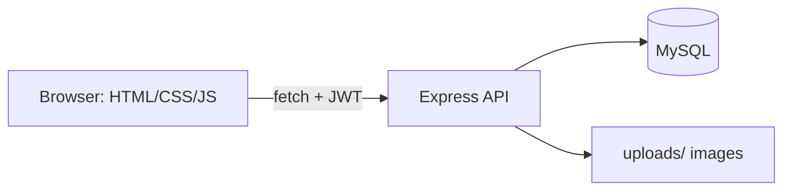

# Lost and Found Management System

## Overview
A web application for a college campus where students can report lost items, report found items, search the listings, claim items, and track an item through to its return. Admins can monitor and moderate everything from a dashboard.

Built with plain HTML/CSS/JavaScript on the front end, Node.js + Express on the back end, and MySQL for storage.

## Features
- Register / login with hashed passwords and JWT sessions
- Report **lost** or **found** items (optional photo upload, max 2 MB)
- Browse with server-side search and filters (keyword, type, category, location, status) and pagination
- Item details page
- **Claim workflow:** claim an item → reporter approves/rejects → only one claim can win → contact details are revealed only after approval
- **Status workflow** with enforced transitions: `LOST/FOUND → CLAIMED → RETURNED → CLOSED`
- In-app notifications (read/unread)
- User dashboard (stats, recent reports, notifications), My Reports, Claims, Profile (incl. password change)
- Admin dashboard: stats, users (deactivate / change role), items (override status, remove), claims
- Role-based authorization enforced on the server

## Technology Stack
| Layer | Technology |
|---|---|
| Frontend | HTML5, CSS3, vanilla JavaScript (fetch API) |
| Backend | Node.js, Express.js |
| Database | MySQL (via `mysql2`, prepared statements) |
| Auth | JWT (`jsonwebtoken`), `bcryptjs` |
| Other packages | `helmet`, `cors`, `express-validator`, `multer`, `dotenv` |

## System Architecture

Request path: `Route → authMiddleware → (adminMiddleware) → validation → controller → MySQL → JSON`. Errors flow to a central error handler. Express also serves the `frontend/` folder, so one `npm start` runs the whole app. See [documentation/system-design.md](documentation/system-design.md).

## Database Design
Four tables: `users`, `items`, `claims`, `notifications`. One user → many items, claims, notifications; one item → many claims. Details and ER diagram: [documentation/database-design.md](documentation/database-design.md).

## User Roles
- **USER:** report items, browse, claim, manage own reports, decide on claims for own items, notifications.
- **ADMIN:** everything a user can do, plus view all users/items/claims, override statuses, remove reports, deactivate users, change roles.

Public registration always creates a `USER`. The first admin comes from `database/seed.sql`.

## API Documentation
Full reference: [documentation/api-documentation.md](documentation/api-documentation.md).

## Installation
Requirements: Node.js 18+ (LTS), MySQL 8, Git.
```bash
git clone https://github.com/<your-username>/lost-and-found-management-system.git
cd lost-and-found-management-system/backend
npm install
```

## Environment Variables
Copy `backend/.env.example` to `backend/.env` and fill in:
| Variable | Meaning |
|---|---|
| `PORT` | Server port (default 5000) |
| `DB_HOST`, `DB_PORT`, `DB_USER`, `DB_PASSWORD` | MySQL connection |
| `DB_NAME` | Database name (`lost_and_found`, matches `schema.sql`) |
| `JWT_SECRET` | Long random string used to sign tokens. Generate one: `node -e "console.log(require('crypto').randomBytes(48).toString('hex'))"` |
| `JWT_EXPIRES_IN` | Token lifetime, e.g. `1d` |
| `CORS_ORIGIN` | Optional, comma-separated allowed origins (needed only if the frontend is hosted elsewhere) |

## Database Setup
With your `.env` filled in, run from `backend/`:
```bash
npm run db:setup
```
This runs `database/schema.sql` (creates the database and tables) and `database/seed.sql` (demo users and items). Use `npm run db:setup -- --no-seed` for an empty database. Alternatively run the two `.sql` files in MySQL Workbench.

Seeded accounts (password for all: `Password@123`): `admin@campus.edu` (ADMIN), `aarav@campus.edu`, `diya@campus.edu`. **Change the admin password** if you ever deploy.

## Running the Application
```bash
cd backend
npm start          # or: npm run dev   (auto-restart with nodemon)
```
Open http://localhost:5000

## Testing
With the server running and the database seeded:
```bash
cd backend
npm run test:smoke
```
This runs an automated end-to-end API test (registration, login, JWT, items, search, claims, statuses, notifications, admin authorization). Manual test checklist and notes: [documentation/testing.md](documentation/testing.md).

## Screenshots
Add your own screenshots to the `screenshots/` folder and link them here after you run the app, for example:
``

## Future Improvements
- Email/SMS notifications; real-time updates
- Rate limiting on login; refresh tokens / httpOnly cookies
- Automated unit tests (Jest) and CI
- Image-based or text-similarity matching of lost and found reports
- Pagination for admin tables; audit log of admin actions
- Deployment pipeline

## Author
Sahil Giri - Computer Science Engineering student
