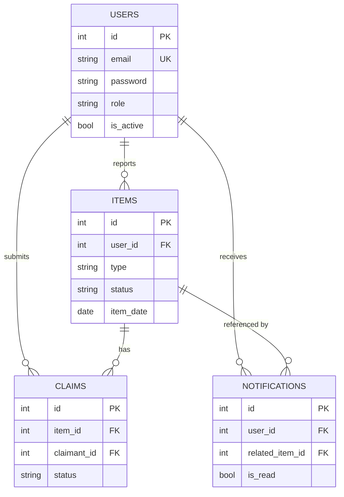

# Database Design

## Tables
**users** - `id`, `name`, `email` (UNIQUE), `password` (bcrypt hash), `phone`, `role` ENUM(USER, ADMIN), `is_active`, `created_at`.

**items** - `id`, `user_id` (FK → users), `title`, `description`, `category`, `type` ENUM(LOST, FOUND), `location`, `item_date`, `image_path`, `status` ENUM(LOST, FOUND, CLAIMED, RETURNED, CLOSED), `created_at`, `updated_at`.

**claims** - `id`, `item_id` (FK → items), `claimant_id` (FK → users), `message`, `status` ENUM(PENDING, APPROVED, REJECTED), `created_at`, `updated_at`. `UNIQUE(item_id, claimant_id)`.

**notifications** - `id`, `user_id` (FK → users), `message`, `is_read`, `related_item_id` (FK → items, nullable), `created_at`.

## Relationships (all one-to-many)
- One user reports many items (`items.user_id`).
- One item has many claims (`claims.item_id`).
- One user makes many claims (`claims.claimant_id`).
- One user receives many notifications (`notifications.user_id`).

## Foreign key behaviour
- Deleting a user or item cascades to dependent items/claims/notifications (`ON DELETE CASCADE`).
- Deleting an item sets `notifications.related_item_id` to NULL, so the notification text remains.

## Indexes and why
| Index | Used by |
|---|---|
| `items(type, status)` | browse/filter by type and status |
| `items(category)` | category filter |
| `items(user_id)` | "My reports", dashboard stats |
| `claims(item_id)`, `claims(claimant_id)` | claims on an item / my claims |
| `UNIQUE claims(item_id, claimant_id)` | prevents duplicate claims at the database level |
| `notifications(user_id, is_read)` | unread count / list |
| `users(email)` UNIQUE | login lookup and duplicate prevention |

Note: keyword search uses `LIKE '%term%'`, which cannot use a normal index. That is fine at campus scale; a FULLTEXT index would be the upgrade.
