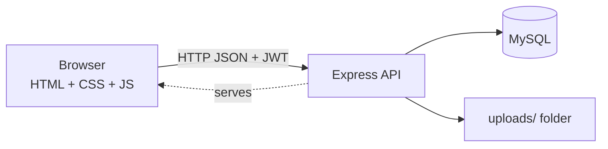
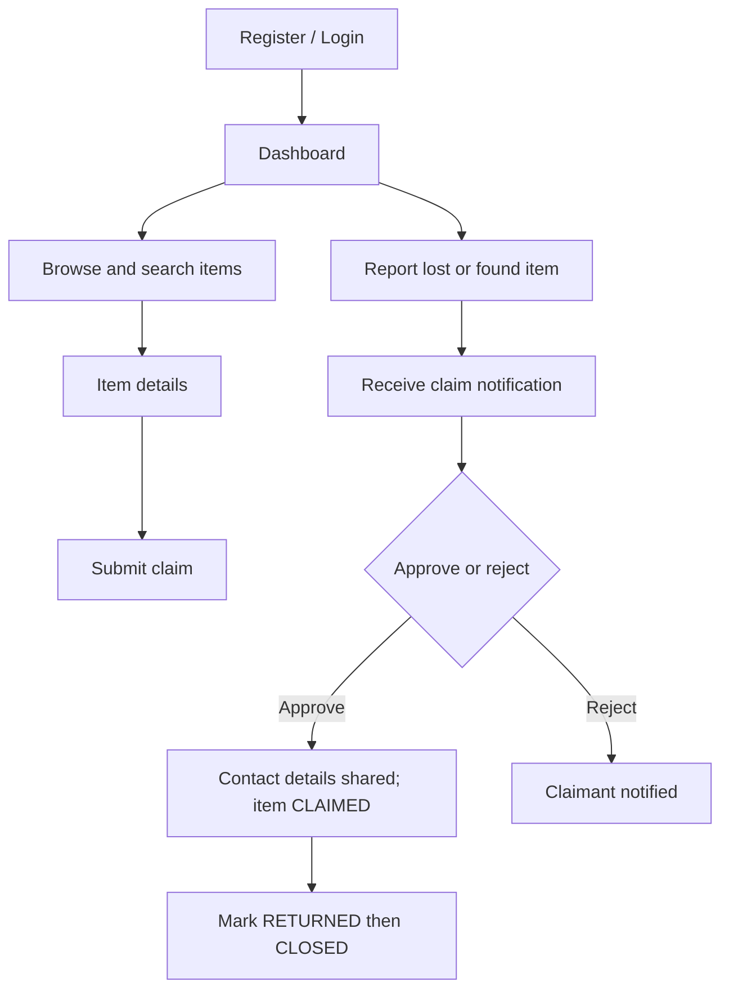
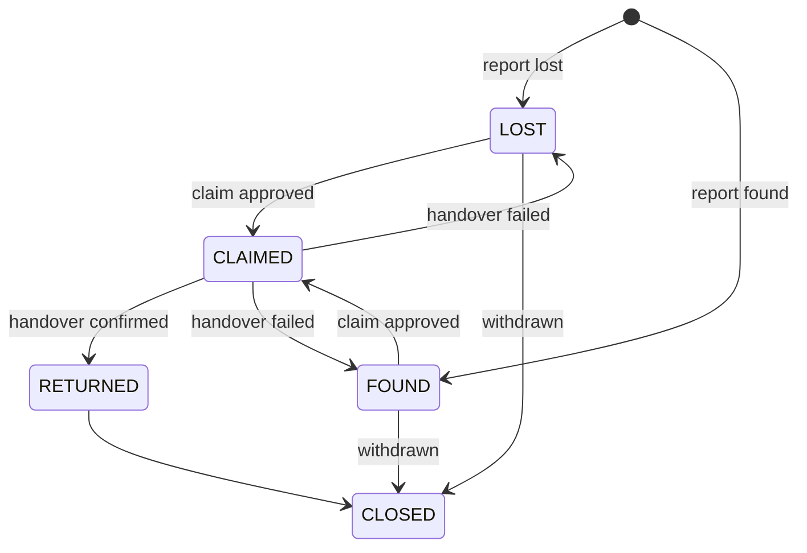

# System Design

## 1. Problem Statement
On a campus, lost items are usually reported through notice boards or WhatsApp groups. Posts get buried, there is no record of who claimed what, and it is hard to verify ownership. Students need one searchable place with a clear process.

## 2. Objectives
- One central, searchable record of lost and found items
- A verification step (claims) before contact details are shared
- Clear status tracking from report to return
- Admin oversight to remove invalid reports

## 3. Functional Requirements
Register/login; report lost/found items; search and filter; view details; submit claims; approve/reject claims; track and update status; in-app notifications; user and admin dashboards; admin moderation.

## 4. Non-Functional Requirements
- **Security:** hashed passwords, JWT, server-side authorization, input validation, parameterized SQL
- **Usability:** responsive UI, clear errors, loading and empty states
- **Reliability:** transactions for multi-step updates; foreign keys for integrity
- **Maintainability:** layered code (routes / middleware / controllers)

## 5. System Architecture

Three tiers: presentation (frontend), application (Express), data (MySQL).

## 6/7. Database Schema and ER Diagram
See [database-design.md](database-design.md).

## 8. User Flow

## 9. Admin Flow
Login as ADMIN → admin dashboard (stats) → Users tab (deactivate, change role) → Items tab (override status, remove) → Claims tab (monitor). All calls go to `/api/admin/*`, which requires both a valid JWT and the ADMIN role.

## 10. API Architecture
REST over HTTP with JSON. Resource-based URLs (`/api/items`, `/api/claims`), verbs for actions, standard status codes. Groups: auth, items (+ nested claims), claims, notifications, users, admin.

## 11. Authentication Flow
1. `POST /api/auth/register` or `/login` validates input. Passwords are hashed with bcrypt (10 salt rounds) and compared with `bcrypt.compare`.
2. The server signs a JWT `{id, role}` with `JWT_SECRET` and an expiry.
3. The browser stores the token (localStorage) and sends `Authorization: Bearer <token>` on each request.
4. `authMiddleware` verifies the signature/expiry, then loads the user from the DB (so deactivated users or role changes apply immediately).

## 12. Authorization Flow
- `authMiddleware` → who are you? (401 if no/invalid token)
- `adminMiddleware` → are you ADMIN? (403 if not). Role is read from the database row.
- Ownership checks live in controllers: only the reporter (or admin) can edit/delete an item or decide a claim.
The frontend hides admin links for UX only; it is never relied on for security.

## 13. Lost Item Workflow
User fills the Report Lost form → `POST /api/items` (type `LOST`) → validated → row inserted with `status = LOST`. Others who find it submit a claim ("I found this").

## 14. Found Item Workflow
Same endpoint with type `FOUND` → `status = FOUND`. The owner submits a claim describing identifying details.

## 15. Claim Workflow
1. Claimant `POST /api/items/:id/claims` (rules: not your own item, item must be open, one claim per user per item, message ≥ 10 chars). Reporter is notified.
2. Reporter `PUT /api/claims/:id` with `APPROVED` or `REJECTED`.
3. On approve (inside a DB transaction): claim → APPROVED, item → CLAIMED, all other pending claims → REJECTED (each claimant notified), approved claimant notified.
4. Contact details (name, email, phone) of the other party are included in API responses only for APPROVED claims.

## 16. Status Workflow

Rules live in `backend/utils/statusRules.js`. Users cannot set `CLAIMED` manually (only claim approval does), cannot skip steps, and can revert from `CLAIMED` only to the item's original type. Admins can set any status through `/api/admin/items/:id/status`.

## 17. Testing
See [testing.md](testing.md).

## 18. Limitations
- JWT is stored in localStorage (readable by injected scripts; mitigated by escaping all output, but httpOnly cookies would be stronger)
- No rate limiting, email verification, or password reset
- Notifications are in-app only and fetched on page load (no real-time push)
- Image uploads are stored on the server's disk (not suitable for hosts with ephemeral storage without a volume)
- No automated unit tests beyond the API smoke test

## 19. Future Improvements
See the README.
